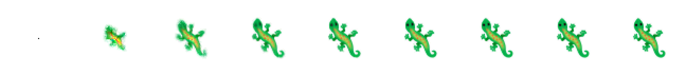
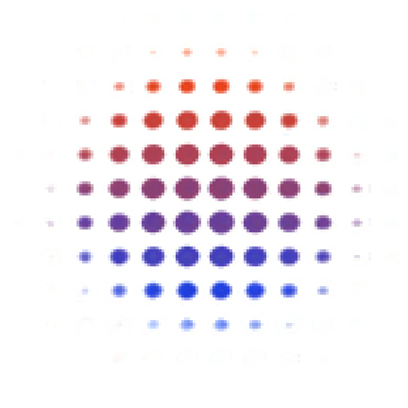
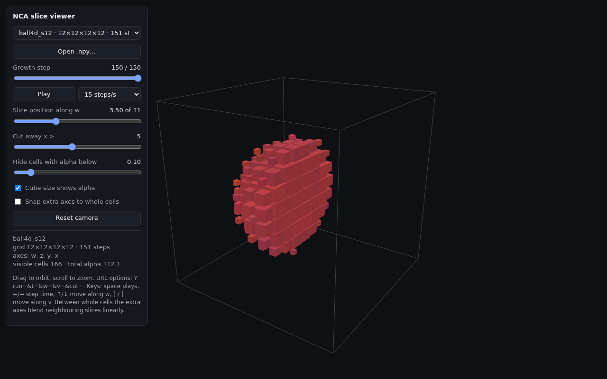

# Higher-dimensional neural cellular automata

Growing Neural Cellular Automata ([Mordvintsev et al., Distill 2020](https://distill.pub/2020/growing-ca)) extended from 2D images to 4D and 5D voxel grids.

The NCA is written once, with the number of spatial dimensions as a parameter. PyTorch stops at `conv3d`, so every neighbourhood operation (Sobel gradients, Laplacian, the alive-cell max-pool) is built from per-axis sliced views of a padded grid. The same code runs in 1D through 5D. A browser viewer shows 3D slices of the results, with sliders that move the slice through the extra dimensions.

**Status:** early research code. The 2D port reproduces the original lizard, and a 4D NCA grows a 4D ball and keeps it stable. Comparing two ideas of a fifth dimension (a spatial 5D lattice, and a tree that branches along the 4th axis) is the next step.

## Results so far

### 2D: reproducing the original

Trained with the original "persistent" recipe (pool of 1,024, batch 8, 64–96 steps, 16 channels, 128 hidden units), 3,000 steps on a laptop CPU:



Grown from one cell, the lizard keeps its shape for at least 1,000 steps (error stays at 10^-4.5 to 10^-4.6). Training samples never run longer than 96 steps.

### 4D: a ball coloured along the 4th axis

A 12⁴ grid, with a target ball coloured red to blue along `w` so the NCA has to use its 4th axis. Each image lays out every 2D (y, x) slice: rows step through `w` and columns through `z`.

| Target | Grown from one cell, step 150 |
|---|---|
|  |  |

Three of four growths reach an error of 10^-3.9 and hold it to step 600. The NCA also becomes nearly mirror-symmetric in z, y and x, which nothing in the training asked for.

That first 4D model stopped growing by sensing the edges of its training grid, so it overgrew a bigger world. Retrained with wrap-around edges and damage training (training error 10^-5.3), it passes `eval_world.py`. Three seeds in a 12×24×24×24 world grow three separate balls of the right size (total 99.4% of three targets), and the balls never merge or reach the world's edge in 800 steps. After half of one ball is erased, it regrows from about 52% to about 81% of its size within 25 steps, then creeps up to about 90% by step 800.

### Viewer



## Quick start

```bash
python3 -m venv .venv
.venv/bin/pip install torch --index-url https://download.pytorch.org/whl/cpu   # or a CUDA build
.venv/bin/pip install -r requirements.txt
.venv/bin/python -m pytest -q tests
```

Train, check and view:

```bash
# 2D lizard (about 3 s/step on a laptop CPU)
.venv/bin/python train_lizard.py --steps 3000

# 4D ball with wrap-around edges and regeneration training
.venv/bin/python train.py --ndim 4 --side 12 --radius 3.5 --padding circular --damage 2 --steps 2000 \
    --out runs/ball4d_wrap

# Several seeds in a bigger world, with damage partway through
.venv/bin/python eval_world.py runs/ball4d_wrap

# Viewer: then open http://localhost:8000/viewer/
.venv/bin/python serve.py
```

Each run writes to `runs/<name>/`:
- `model.pt`: the trained model
- `loss.jsonl`: the loss log
- snapshot images
- `growth_rgba.npy`: every step grown from one seed, as uint8 `(T, *grid, 4)`. The viewer lists these automatically.

The runs in this repository keep their models, logs, metrics and images, but not the `growth_rgba.npy` recordings, which are too big for GitHub (up to 180 MB each). `eval_world.py runs/<name>` makes a new recording from a saved ball model; the others come from retraining.

## Layout

| File | What it does |
|---|---|
| `nca.py` | The NCA for any number of dimensions: perception (`sobel` or `isotropic`), alive mask, update rule, optional gradient checkpointing, optional one-way (causal) time axis |
| `train_lizard.py` | Reproduces the 2D Distill lizard (reference run) |
| `train.py` | Trains on n-D targets (ball, shell) with pool training, optional damage and wrap-around edges; `--levels` swaps in the hierarchical NCA |
| `bounce.py` | Exact bouncing-ball targets: the 5D lattice and the tree that forks at the first impact |
| `hier_nca.py` | A hierarchical NCA: coarser copies of the grid pass a summary up and context back down within every step, so one step reaches 7–10 cells with 3 levels instead of 1. Time is never coarsened. The blocks move by a random offset every step, so they can't serve as a coordinate grid. The state is still one grid, so it drops into the training scripts |
| `tree_nca.py` | A 4D NCA whose `w` axis is a tree (parent and children as the `w` neighbours); on a chain it equals the 4D NCA |
| `train_bounce.py` | Trains the bouncing-ball comparison: `--mode lattice`, `tree`, `tree-down` (one-way links) or `independent` |
| `train_forecast.py` | Forecasts the bounce from the observed fall with unknown bounciness: K candidate futures trained with the energy score, `--mode lattice` (candidates see each other), `independent`, or `tree` (one shared fall, candidates branch at the impact) |
| `eval_world.py` | Runs a trained model in a bigger world with several seeds; checks size, separation and regrowth |
| `serve.py` | Local server for the viewer (127.0.0.1 only); lists runs at `/api/runs` |
| `viewer/index.html` | three.js viewer: growth-step scrubbing, extra-axis sliders with blending, cut-away, alpha threshold |
| `tests/` | Checks the n-D operators against `conv2d`/`conv3d`/`max_pool` and brute-force 3ⁿ stencils in 4D/5D, sparse/dense/checkpointed equivalence, the bounce physics, the tree NCA against the 4D NCA, one-way time, the hierarchical NCA's pooling, reach and one-way time, and the energy score and forecast setup |

## Implementation notes

- **Perception without conv4d.** The grid is padded once, and each neighbour is a sliced view. The n-D Sobel along an axis is a central difference on that axis with [1, 2, 1] smoothing on the others, which in 2D is exactly the original kernel. The smoothing passes are shared between axes: 12 one-axis passes in 4D instead of 16.
- **Isotropic perception** (identity, Laplacian, gradient magnitude) gives 3C inputs in any dimension. One set of weights could then run in 2D, 3D and 4D.
- **`skip_dead=True`** runs the per-cell network only on cells that are alive and updating that step. In 4D/5D a shape fills a small part of the grid, so this is much cheaper. It differs from the original rule only in whether a dead cell's update can briefly keep a live neighbour alive, which is why it's off for the reference lizard.
- **`compile=True`** fuses perception with `torch.compile`, about 4× faster in 4D on CPU.
- **Cost** grows as side^n: 32⁴ is about 1M cells. On a laptop CPU a 12⁴ training step takes about 3 seconds, so bigger 4D and 5D runs need a GPU.

## Roadmap

- Bouncing-ball test: a ball's history frozen into the 4th axis, then built two ways:
  - a spatial 5D lattice, with bounciness varying smoothly along `v`
  - a tree that forks along `w` at the first impact
  
  Compare both against independent runs on fit, regrowth and damage leaking between branches.
- Does information flowing backward along `w` reshape the trunk? Compare two-way and parent-to-child links in the tree.
- Hierarchical NCA (`hier_nca.py`). First 4D ball run (`ball4d_r35_wrap_L3`, 12⁴ box, fixed blocks): 10× lower error than the flat model and full regrowth, but it learned the box. Its ball snapped to multiples of 4 cells instead of following the seed, and outside the box (bigger world or zero padding) it grew to only 82–86% size, with neighbouring balls pushing each other bigger without touching. In a 12⁴ box every coarse cell holds part of the ball, so the coarse levels never see empty space. Rerun with moving blocks in a 16⁴ box against a flat control at 16⁴ (`ball4d_s16_r35_wrap_L3s`, `ball4d_s16_r35_wrap`; 1000 steps, batch 4): the ball now follows its seed and grows to full size in any world, error is 2.6× lower than flat at equal steps, it grows faster and regrows half a ball in 25 steps (flat: still short after 100), at 1.8× the cost per step (about even at equal training time). Balls 2 cells apart change each other's size (91–117% together, 100% alone) without touching. Next: a task where reach matters, and several balls in training if interaction should be controlled.
- Live viewer mode: click to plant new seeds or erase regions while the model runs.
- Larger grids (16⁴, 5D) on a GPU.

## Credits

- Mordvintsev, Randazzo, Niklasson and Levin, [Growing Neural Cellular Automata](https://distill.pub/2020/growing-ca), Distill 2020.
- Lizard target: `data/lizard_128.png` is the 🦎 emoji from [Noto Emoji](https://github.com/googlefonts/noto-emoji) v2.047, Apache License 2.0.

## License

MIT; see [LICENSE](LICENSE). The lizard image in `data/` keeps its own Apache 2.0 licence (Noto Emoji).
